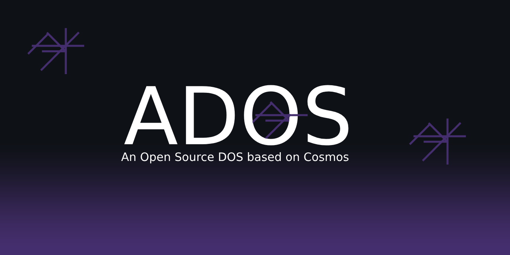

This is just a console.

## Avaiable Commands
- help - show all commands.
- cd - set directory
- mkfile - make a new file
- mkdir - make a new directory
- delfile - delete file
- deldir - delete directory
- about - show version and some infoemation about os
- time - shows time and date
- bsod - makes a Black Screen OF DEATH
- dir - shows directory
- readfile - read the file
- editfile - edit file
- rewritefile - rewriting the file
- runfile - runs a file
